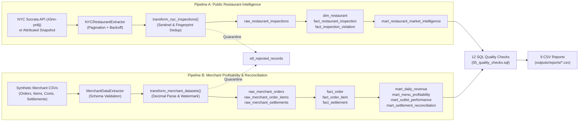

# MarginPilot ETL — Restaurant Profitability & Competitive Intelligence Pipeline

**MarginPilot ETL** is a production-structured, local-first **Data Engineering portfolio project** built with Python, pandas, SQL (PostgreSQL 16 + zero-dependency SQLite 3.40+ local fallback), Docker Compose, and automated data-quality testing.

It solves a classic hospitality analytics challenge: **combining public regulatory & market intelligence with private multi-channel merchant transaction data** to answer why high-volume restaurants suffer margin compression across third-party delivery platforms.

---

## 1. Business Problem & Data Boundaries

Restaurants operating across dine-in (`DIRECT_POS`) and third-party delivery marketplaces (`UBEREATS_SIM`, `DOORDASH_SIM`, `GRUBHUB_SIM`) struggle to answer seven core questions:

1. **Contribution Profit**: Which menu items generate the highest true contribution profit after food cost, packaging, and platform commissions?
2. **Low-Margin Bestsellers**: Which high-volume menu items silently erode margins?
3. **Delivery Fee Impact**: How much do marketplace commissions, merchant-borne delivery charges, and allocated ad spend compress outlet profitability?
4. **Settlement Reconciliation**: Do gateway settlement payouts match configured, effective-dated merchant commission agreements?
5. **Outlet Benchmarking**: Which outlets perform better financially and why?
6. **Market Concentration**: How dense is the surrounding public restaurant landscape by borough, ZIP code, and cuisine?
7. **Inspection Compliance**: How do public health inspection grades and critical violation rates vary across neighborhoods and cuisines?

### Strict Separation of Public vs. Synthetic Data
- **Source A — Genuine Public Data**: [DOHMH New York City Restaurant Inspection Results (`43nn-pn8j`)](https://data.cityofnewyork.us/Health/DOHMH-New-York-City-Restaurant-Inspection-Results/43nn-pn8j) ([Socrata API Foundry Documentation](https://dev.socrata.com/foundry/data.cityofnewyork.us/43nn-pn8j)). Public records provide real establishment permits (`CAMIS`), locations, cuisines, inspection scores, grades, and violation citations. They **do not** reveal competitor sales, order volumes, or profits.
- **Source B — Synthetic Merchant Data**: Generated deterministically (`src/generators/synthetic_data.py`, fixed seed `42`) for 3 fictional NYC outlets (`OUTLET_MN_10036`, `OUTLET_MN_10018`, `OUTLET_BK_11209`), 36 menu items, 2 effective-dated cost periods, 15 commission tier agreements, and 92 days of transactions (`11,513` valid orders, `22,933` order line items, and `11,458` settlements). Synthetic transactions are never attached to real identifiable restaurants.

---

## 2. ETL Architecture & Data Model



---

## 3. Technology Stack

| Component | Technology | Purpose |
|---|---|---|
| Language | Python 3.11+ | Core extraction, validation, orchestration, and CLI |
| API Ingestion | `requests` | Socrata Open Data API pagination, timeouts, and HTTP 429 exponential backoff |
| Transformation | `pandas` + `decimal.Decimal` | Schema validation, currency-safe base-10 rounding, date parsing, and deduplication |
| Database | PostgreSQL 16 (`docker-compose.yml`) + SQLite 3.40+ fallback | Primary relational warehouse (`psycopg`) with automatic local SQLite fallback for container/offline environments |
| SQL | PostgreSQL SQL (`sql/01_schema.sql` – `05_quality_checks.sql`) | CTEs, window functions (`ROW_NUMBER`, `RANK`, `DENSE_RANK`, `LAG`, rolling frames), effective-dated joins, `ON CONFLICT` upserts |
| CLI | `argparse` (`python -m src`) | Zero-framework CLI for data generation, schema setup, full/incremental runs, and reporting |
| Testing | `pytest` & `unittest` | 8 automated unit/integration tests + 12 SQL data-quality assertions |

---

## 4. Key Engineering Challenges Solved

1. **Correct Grain Modelling & Non-Multiplication of Inspection Scores**:
   - In `43nn-pn8j`, an inspection citing 3 violations produces 3 rows, each repeating the total inspection `score`. Aggregating directly on the raw table multiplies scores. We deduplicate into `dim_restaurant` (1 row per `camis`), `fact_restaurant_inspection` (1 row per `(camis, inspection_date, inspection_type)` using `MAX(score)`), and `fact_inspection_violation` (1 row per `(inspection_key, violation_code)`).
2. **Sentinel Date (`1900-01-01`) Handling**:
   - Establishments with `inspection_date = 1900-01-01` are newly permitted venues awaiting their first inspection. We retain them in `dim_restaurant` (`has_completed_inspection = FALSE`) and exclude them from `fact_restaurant_inspection`.
3. **Idempotent Upserts & Watermark Incremental Loading**:
   - Every record receives a SHA-256 `record_fingerprint`. Upserts execute `ON CONFLICT (...) DO UPDATE ... WHERE table.record_fingerprint != EXCLUDED.record_fingerprint`.
   - Running the full pipeline twice inserts `0` duplicate rows (`unchanged_records = 11,398` merchant orders and `657` public rows).
   - Running `python -m src generate-incremental && python -m src run --incremental` uses `etl_source_watermarks` (`source_updated_at > '2026-10-29 22:47:00'`) to process only the `120` newly added orders and `15` existing orders updated to `REFUNDED`.
4. **Missing Cost Quarantine vs. Zero-Cost Distortion**:
   - Three seasonal specials (`MENU_012`, `MENU_024`, `MENU_036`) have `NULL` ingredient costs. Rather than defaulting to `$0.00` cost, the SQL pipeline sets `has_missing_cost_flag = TRUE`, sets `contribution_profit_usd = NULL`, and labels those items `INCOMPLETE_COST`.
5. **8-Status Settlement Reconciliation**:
   - Reconciles expected payout (using effective-dated commission tiers, `$0.30 + 2.9%` payment processing fees, refunds, delivery pass charges, and ad spend) against gateway settlement records across 8 statuses: `MATCHED`, `WITHIN_TOLERANCE`, `POSSIBLE_OVER_DEDUCTION`, `POSSIBLE_UNDER_DEDUCTION`, `PARTIAL_SETTLEMENT`, `MISSING_SETTLEMENT`, `INSUFFICIENT_DATA`, and `UNMATCHED_ADJUSTMENT`.

---

## 5. Reproducible Local Setup & Demo Commands

```bash
# 1. Clone and enter repository
git clone <repository-url>
cd marginpilot-etl

# 2. Copy environment configuration
cp .env.example .env

# 3. (Optional if Docker is installed) Start PostgreSQL 16 container
# If Docker/psycopg is unavailable, DatabaseManager automatically uses embedded SQLite 3.40+
docker compose up -d

# 4. Generate synthetic merchant data (11,393 valid orders + edge cases) & NYC snapshot (660 records)
python3 -m src generate-data

# 5. Initialize database schema (sql/01_schema.sql)
python3 -m src init-db

# 6. Run full ETL pipeline (Public + Merchant + SQL Marts + 12 Data Quality Assertions)
python3 -m src run

# 7. Run pipeline a second time to verify idempotency (0 inserts, 0 updates, 11,398 unchanged)
python3 -m src run

# 8. Append incremental batch (120 new orders + 15 refunded updates) & run incremental load
python3 -m src generate-incremental
python3 -m src run --incremental

# 9. Export all 9 analytical CSV reports to outputs/reports/
python3 -m src reports

# 10. Run automated test suite (works with both pytest and standard-library unittest)
pytest -v || python3 -m unittest discover -s tests -v
```

---

## 6. Verified Output & Sample Insights

### A. Pipeline Audit & Idempotency Log (`outputs/reports/data_quality_summary.csv`)

| Pipeline Run ID | Dataset Name | Execution Mode | Input Records | Valid Records | Inserted Records | Updated Records | Duplicate / Unchanged Records | Rejected Records | Test Results | Status |
|---|---|---|---:|---:|---:|---:|---:|---:|---|---|
| `RUN_PUBLIC_..._7b2bc6` | `public_nyc_inspections` | `full` | 660 | 654 | 654 | 0 | 3 | 3 | `12/12 SQL Assertions PASS` | `SUCCESS` |
| `RUN_MERCHANT_..._2eb0d6` | `merchant_profitability` | `full` | 11,402 | 11,393 | 11,393 | 0 | 5 | 6 | `12/12 SQL Assertions PASS` | `SUCCESS` |
| `RUN_PUBLIC_..._d90219` | `public_nyc_inspections` | `full` (repeat) | 660 | 654 | **0** | **0** | **657** | 3 | `12/12 SQL Assertions PASS` | `SUCCESS` |
| `RUN_MERCHANT_..._0ba598` | `merchant_profitability` | `full` (repeat) | 11,402 | 11,393 | **0** | **0** | **11,398** | 6 | `12/12 SQL Assertions PASS` | `SUCCESS` |
| `RUN_MERCHANT_..._7825f7` | `merchant_profitability` | `incremental` | 11,522 | 135 | **120** | **15** | **0** | 6 | `12/12 SQL Assertions PASS` | `SUCCESS` |

### B. Outlet Profitability & Surrounding Public Market Context (`outputs/reports/merchant_actionable_insights.csv`)

| Outlet ID | Fictional Outlet | ZIP | Cuisine | Orders | Net Revenue | Contribution Profit | Margin % | 3P Delivery Share % | Flagged Low-Margin Bestseller | Flagged Settlement Discrepancies | Public Same-Cuisine Restaurants in ZIP (% Grade A) |
|---|---|---|---|---:|---:|---:|---:|---:|---|---:|---|
| `OUTLET_BK_11209` | Verrazano Spice & Noodle Table | `11209` | Thai | 3,455 | $121,946.59 | $51,971.22 | **45.79%** | 57.68% | None flagged | 122 ($426.00) | 5 active Thai (`40.00%` Grade A) |
| `OUTLET_MN_10018` | Midtown Lotus Bowl & Dumpling | `10018` | Asian/Asian Fusion | 3,821 | $126,548.67 | $46,640.89 | **39.93%** | 74.77% | `Wagyu Beef Teriyaki Bento` (`23.69%` margin) | 124 ($417.00) | 5 active Asian/Asian Fusion (`60.00%` Grade A) |
| `OUTLET_MN_10036` | Harbor & Hearth Kitchen | `10036` | American | 4,237 | $143,461.35 | $41,525.43 | **31.71%** | 85.46% | `Prime Ribeye Steak Sandwich` (`21.05%` margin) | 152 ($525.00) | 9 active American (`55.56%` Grade A) |

---

## 7. Representative SQL Examples

1. **Deduplicating Multi-Violation Inspections (`sql/02_staging.sql`)**: Uses `MAX(score)` grouped by `(camis, inspection_date, inspection_type)` with `WHERE is_uninspected_sentinel = FALSE` so multi-violation inspections never multiply scores.
2. **Latest Valid Inspection per Restaurant (`sql/04_insights.sql` — Query 4)**: Uses `ROW_NUMBER() OVER (PARTITION BY fi.camis ORDER BY fi.inspection_date DESC, fi.inspection_key ASC)` on `fact_restaurant_inspection`.
3. **7-Day Rolling Revenue & Day-over-Day Delta (`sql/03_marts.sql`)**: Uses `SUM(net_merchant_revenue_usd) OVER (PARTITION BY outlet_id, channel ORDER BY order_date ROWS BETWEEN 6 PRECEDING AND CURRENT ROW)` and `LAG(net_merchant_revenue_usd, 1) OVER (...)`.
4. **Low-Margin Bestseller Detection (`sql/03_marts.sql`)**: Combines `DENSE_RANK() OVER (PARTITION BY outlet_id ORDER BY total_quantity_sold DESC)` with `RANK() OVER (... ORDER BY total_contribution_usd DESC)` to flag items in the top 3 by volume whose contribution margin falls below `28%`.

---

## 8. Known Limitations & Verification Transparency

- **Synthetic Financial Data**: All merchant orders, item costs, commission agreements, and settlements are synthetic.
- **Public Snapshot vs. Live Socrata API**: By default (`NYC_USE_OFFLINE_SAMPLE=true`), the pipeline runs against the attributed 660-record snapshot (`data/sample/nyc_inspections_sample.json`) so offline demos are 100% reproducible. Run `python3 -m src refresh-nyc-data` or `python3 -m src run --live-nyc` when internet connectivity is available to fetch live pages from `https://data.cityofnewyork.us/resource/43nn-pn8j.json`.
- **Execution Environment Verification**:
  - **Executed & Verified Live**: Synthetic data generation (`11,522` raw orders), NYC snapshot ingestion (`660` records), pandas cleaning & quarantine (`etl_rejected_records`), all SQL transformations (`01_schema.sql` through `05_quality_checks.sql`), repeated-run idempotency, watermark incremental loading, all 9 CSV reports in `outputs/reports/`, and all 8 automated test cases (`python3 -m unittest discover -s tests -v`) were executed and verified end-to-end using the embedded SQLite 3.40+ engine.
  - **Container-Bounded Components**: Because the build sandbox container does not run a Docker daemon, a live PostgreSQL server process, or outbound network access, `docker compose up -d` and live `psycopg` socket connections to PostgreSQL 16 are provided as complete, runnable configurations for local developer machines with Docker installed.
